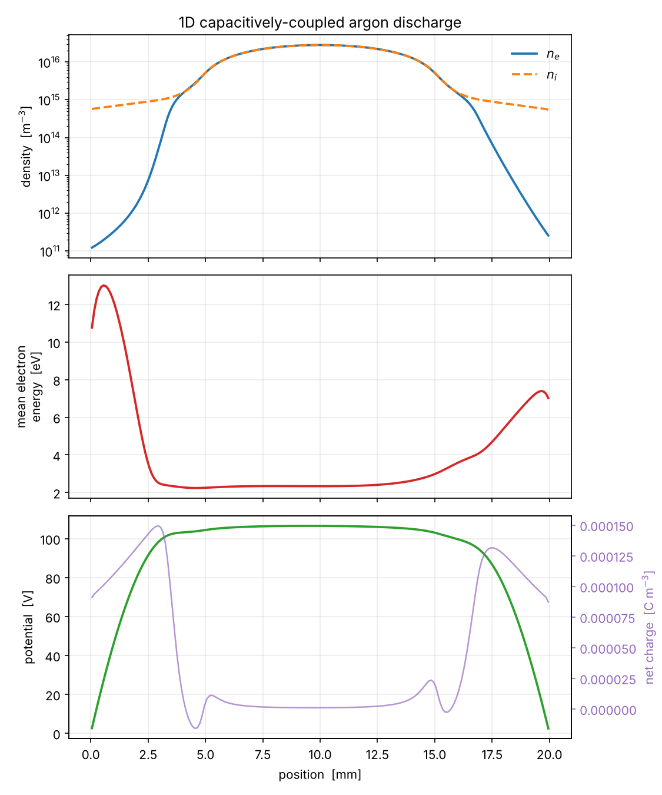

# ccp1d

A 1D drift-diffusion model of a capacitively-coupled RF discharge in argon,
written in C++17. Electron and ion continuity are coupled to Poisson's equation
and to an electron energy equation, closed with the local mean energy
approximation.

It reproduces the structure you expect from a CCP: a quasineutral bulk, two
space-charge sheaths, and an electron temperature that is low in the bulk and
rises sharply where the field does work. It also checks itself: the test suite
verifies global energy conservation, mirror symmetry, and the observed order of
accuracy, and the solver reports at runtime how much of the answer its
numerical guards are setting.



*End-of-cycle snapshot after 3000 RF cycles at the default settings.*

## Results

1 Torr, 300 V, 13.56 MHz, 20 mm gap, 200 cells, 1000 steps per cycle, run for
3000 RF cycles to a cycle-to-cycle drift of 7.7e-6 (`./build/ccp1d --cycles 3000`):

| quantity | value |
| --- | --- |
| mean electron density (gap and cycle average) | 1.04e16 m^-3 |
| peak electron density | 2.81e16 m^-3 |
| bulk electron temperature | 1.57 V |
| peak mean electron energy (end of cycle / max over cycle) | 13.0 / 18.1 eV |
| electron Joule power | 8.21e3 W m^-3 |
| ion Joule power | 1.12e4 W m^-3 |
| total absorbed power | 1.94e4 W m^-3 |
| electron drift cap duty | 27.6% of face evaluations |

Two things about these numbers are easy to get wrong:

- **Convergence takes thousands of cycles, not hundreds.** The equilibration
  time is the ambipolar diffusion time, `(L/pi)^2 / (mu_i Te)`, about 1.9e-4 s
  or roughly 2600 RF periods at these settings. At the default of 400 cycles,
  which keeps a run near a minute, the mean density is still about 35% below
  its periodic steady state.
  The solver warns while the cycle drift is above 1e-4.
- **The ions absorb more than half the power** (58% here). The electron term
  `-Gamma_e . E` is what drives the energy equation, but ion Joule heating
  `e Gamma_i . E` in the sheaths is larger at this pressure, so both are
  reported. Earlier versions reported only the electron term as "absorbed
  power".

## Model

State variables, all at cell centres:

| symbol | quantity | units |
| --- | --- | --- |
| `n_e` | electron density | m^-3 |
| `n_i` | Ar+ density | m^-3 |
| `n_eps` | electron energy density | eV m^-3 |

The governing system is

```
  d(n_e)/dt   + div(Gamma_e)   =  k_iz N n_e
  d(n_i)/dt   + div(Gamma_i)   =  k_iz N n_e
  d(n_eps)/dt + div(Gamma_eps) = -Gamma_e . E  -  losses
  div(eps0 E) = e (n_i - n_e)
```

with drift-diffusion fluxes `Gamma = +-mu n E - D grad(n)`, energy transported at
5/3 of the particle mobility and diffusivity, and every rate coefficient and
diffusivity evaluated at the local electron temperature `Te = (2/3) n_eps / n_e`.

Reaction set: elastic scattering, excitation (11.55 eV), and ionisation
(15.76 eV), using the argon rate fits from Lieberman & Lichtenberg. Secondary
electron emission at the electrodes is included with a configurable yield.

## Numerics

**Scharfetter-Gummel flux discretisation.** Central differencing of a
drift-diffusion flux goes unstable once the cell Peclet number exceeds two,
which in a sheath happens immediately; naive upwinding is stable but smears the
sheath edge across several cells. Scharfetter-Gummel exponential fitting
interpolates between the two. In the drift-dominated sheath it reduces to
upwinding, so the scheme is first order there, and the convergence study below
confirms that.

The transport part of each density matrix is an M-matrix. The electron
equation also puts ionisation on the diagonal, `-k_iz N`, which erodes
diagonal dominance; at the defaults the largest `k_iz N dt` is about 0.06, so
the margin is real but not unlimited. The density floors after each solve are
a backstop and have not been seen to activate.

**Semi-implicit Poisson.** Coupling Poisson explicitly to the continuity
equations imposes the dielectric relaxation limit `dt < eps0 / (e mu_e n_e)`,
which at 1e16 m^-3 is about 4 ps, roughly twenty times smaller than the
timestep needed to resolve 13.56 MHz. Advancing the charge density inside
Poisson's equation and writing the drift current against the unknown field moves
the conductivity onto the left-hand side as an effective permittivity,

```
  eps_eff = eps0 + dt e (mu_i n_i + mu_e n_e)
```

which preserves the tridiagonal structure and removes the restriction.

It is not free. Gauss's law is enforced against a predicted charge density
rather than the one the transport solves then produce, so the total current
`J_cond + eps0 dE/dt` is not exactly uniform in x. At the default timestep the
violation averages 1.8% of the peak current over a cycle (3.9% worst) and it
is first order in dt; `test_conservation` pins it to that scaling.

The conductivity in `eps_eff` is built from the same limited drift the
transport solve applies. Where the electron drift cap binds, the flux responds
to the field with mobility `v_cap/|E|`, not `mu_e`; using the bare mobility
there overstated sigma and enforced Gauss's law against a current the
continuity equation never carried. Matching the two cut the continuity
violation by 2.7x.

`--explicit-poisson` restores the naive treatment, and the failure mode is worth
seeing. It tracks the semi-implicit solution to four significant figures while
the discharge is still filling (3.9263e15 against 3.9287e15 at cycle 120) and
then goes to NaN between cycles 120 and 140, as the rising density pushes the
dielectric relaxation time below the timestep. The instability is invisible
until the plasma density crosses the threshold, which is exactly what makes it
worth designing out rather than tuning around.

**Gummel iteration.** Each timestep sweeps Poisson, electrons, ions, and energy
in sequence, repeated a few times so the strongly nonlinear coupling between
space charge and field is converged before the step is accepted. Three sweeps
is converged: going to 6 or 12 changes the absorbed power by less than 0.02%.
Rate coefficients are evaluated once per sweep, before any species moves, so
the electron source, the ion source and the energy cost of ionisation all see
the same `k_iz`. Re-evaluating them between the electron and ion updates, as an
earlier version did, created electrons and ions in slightly different numbers:
a spurious net charge source of 8.6e-5 of the ionisation rate, now 5.0e-6 and
vanishing with dt. Each sub-solve is a tridiagonal system handled by the
Thomas algorithm.

## Verification

`ctest` runs two suites. `test_numerics` checks the building blocks in
isolation; `test_conservation` checks that the assembled solver obeys the laws
those blocks are supposed to add up to. Every quantity in the second suite is
reconstructed from the solver's public state by `include/verification.hpp`,
independently of the solver's own arithmetic, so a sign error or a missing
factor shows up as a broken balance instead of being reproduced by the check.

| check | measured | tolerance |
| --- | --- | --- |
| Poisson operator vs analytic parabola, observed order | 2.000 | 1.9 to 2.1 |
| vacuum gap: linear potential, E = V/L on every face | roundoff | 1e-9 |
| Bernoulli function vs long-double reference | roundoff | 1e-14 |
| global electron energy balance over one cycle | 9.3e-5 of input | 1e-3 |
| global charge balance: net charge vs net wall current | 5.0e-6 of production | 2.5e-5 |
| undriven decay stays mirror-symmetric | 4.9e-14 | 1e-10 |
| driven: n(x,t) vs n(L-x,t+T/2), relative to cycle drift | 1.4 | < 3 |
| observed order in space / time | 0.84 / 0.91 | 0.6 to 1.4 |
| current-continuity error, order in dt | 0.96 | 0.6 to 1.4 |

The energy tolerance is set below the smallest physical term in the budget
(secondary-electron energy, about 1.4e-3 of input) so that an error even there
fails it. The two residuals are not zero because the solver freezes rate
coefficients for a Gummel sweep while the checks evaluate the end-of-step
state; both vanish faster than dt (energy: 5.5e-4, 9.3e-5, 1.4e-5 at 500,
1000, 2000 steps per cycle).

To confirm the suite can fail, bugs were planted one at a time:

| planted bug | caught by |
| --- | --- |
| wall energy coefficient 1/3 changed to 1/4 | energy balance |
| secondary-electron energy sign flipped at one wall | energy balance, undriven symmetry |
| Ohmic heating doubled | six checks |
| electron secondary-emission sign flipped at one wall | energy balance, both symmetry tests, convergence |
| elastic loss factor 3 changed to 2 | energy balance |
| electron and ion ionisation sources mismatched by 1% | charge balance (reads exactly 1.0e-2) |
| energy transport factor 5/3 changed to 1 | **not caught** |

The last row is a real gap. Interior fluxes telescope, so no global balance can
see a wrong transport coefficient, and the symmetry and order checks are
indifferent to it. Closing it needs a manufactured-solution test of the
transport operators.

`ccp1d_audit` measures the same things at any resolution, plus diagnostics
that are not pass/fail. With `--convergence` it adds grid and timestep studies
with Richardson error estimates. At the defaults after 100 cycles
(`./build/ccp1d_audit --cycles 100 --convergence`):

| refinement | observed order | Richardson error at the middle level |
| --- | --- | --- |
| cells 100 / 200 / 400 | 0.87 | 200 cells reads 2.8% low |
| cells 200 / 400 / 800 | 0.94 | 400 cells reads 1.4% low |
| steps 250 / 500 / 1000 | 0.93 | 500 steps reads 1.7% high |
| steps 500 / 1000 / 2000 | 0.98 | 1000 steps reads 0.85% high |

So the default resolution carries about 3% spatial and 0.9% temporal error in
the mean density, of opposite sign. The two partly cancel at the defaults; that
is coincidence, not design, and it will not hold at other settings.

## Validity

The drift-diffusion closure needs the electron mean free path to be short
compared with the gradient scale. In a 20 mm gap:

| pressure | mean free path | mfp / gap |
| --- | --- | --- |
| 100 mTorr | 31 mm | 1.6 |
| 300 mTorr | 10 mm | 0.5 |
| 1 Torr | 3.1 mm | 0.16 |

Three limits matter even at 1 Torr, and the code now measures each of them:

- **The electron drift cap is doing physics.** A constant mobility has no
  high-field saturation, so in the sheath `mu_e E` reaches about five times the
  thermal speed. The drift is capped at `v_th`, and at the defaults that cap is
  active on about 28% of interior-face evaluations, out to roughly 5 mm from
  each electrode. Removing it (`--drift-cap 0`) changes the electron power by
  about 21% and the ion power by about 27%. Inside the capped region the model
  is free-streaming at `v_th`, not drift-diffusion. The duty is printed every
  run.
- **The rate fits are extrapolated.** The Lieberman fits are calibrated for
  about 1 to 7 V. At 1 Torr the hottest cells reach about 12 V and roughly 15
  to 20% of all ionisation comes from above 7 V.
- **The mean-energy ceiling is inert.** The 60 eV ceiling has not been seen to
  bind; the peak mean energy over a cycle is about 18 eV at 1 Torr and 21 eV at
  100 mTorr.

At 100 mTorr the model is outside its range and says so in its diagnostics:
the drift cap is active on 93% of face evaluations, so electron transport
across nearly the whole gap is set by the cap rather than the mobility, and
98.5% of ionisation comes from above the fits' calibrated range
(`./build/ccp1d_audit --pressure 100 --cells 100 --steps 500 --cycles 60`).
Below a few hundred mTorr, a kinetic treatment is required.

## Building

```
cmake -S . -B build -DCMAKE_BUILD_TYPE=Release
cmake --build build -j
ctest --test-dir build --output-on-failure
```

Requires CMake 3.16+ and a C++17 compiler. No external dependencies. Every
target, tests and tools included, builds warning-clean under
`-Wall -Wextra -Wpedantic -Wshadow -Wconversion`. The test suite takes about
ten seconds.

## Running

```
./build/ccp1d                                    # defaults: 1 Torr, 300 V, 13.56 MHz
./build/ccp1d --cycles 3000                      # to periodic steady state
./build/ccp1d --pressure 500 --voltage 200
./build/ccp1d --drift-cap 0                      # remove the electron drift cap
./build/ccp1d --help

./build/ccp1d_audit                              # verification report
./build/ccp1d_audit --cycles 100 --convergence   # plus grid and dt studies
```

Profiles are written as CSV and can be plotted with

```
python3 tools/plot_profiles.py profiles.csv docs/profiles.png
```

## Next steps

In rough order of value:

1. Tabulated `mu(E/N)`, `D(E/N)` and rate coefficients from a Boltzmann solver,
   replacing the constant-mobility closure, its speed cap, and the extrapolated
   rate fits. The audit numbers above are the case for doing this first.
2. A manufactured-solution test for the transport operators, the one class of
   error the current suite cannot see.
3. Metastable argon as a fourth species, which matters for the ionisation
   balance well before anything below it does.
4. Kokkos or CUDA offload of the flux assembly and tridiagonal solves. The
   assembly is embarrassingly parallel across faces; the tridiagonal solves need
   cyclic reduction rather than Thomas.
5. MPI domain decomposition, for extension to 2D where the tridiagonal structure
   is lost and a Krylov solve with a multigrid preconditioner is needed instead.

## References

- Scharfetter & Gummel, *IEEE Trans. Electron Devices* **16** (1969) 64.
- Ventzek, Hoekstra & Kushner, *J. Vac. Sci. Technol. B* **12** (1994) 461.
- Lieberman & Lichtenberg, *Principles of Plasma Discharges and Materials
  Processing*, 2nd ed., Wiley (2005).
- Hagelaar & Pitchford, *Plasma Sources Sci. Technol.* **14** (2005) 722.
